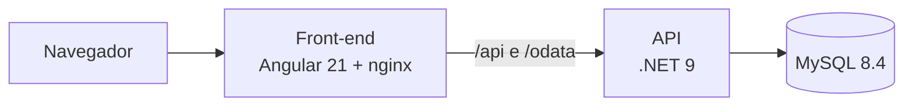
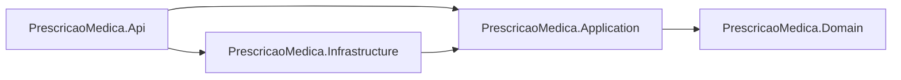
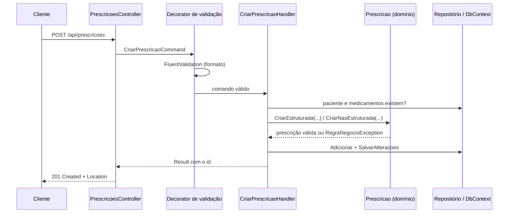

# Arquitetura

## Visão geral



Uma aplicação de prescrição com dois artefatos independentes, cada um com sua imagem Docker e seu pipeline:
- **API (.NET 9):** regras de negócio, CRUD REST da prescrição e consultas OData.
- **Front-end (Angular 21):** servido por nginx, que também encaminha `/api` e `/odata` para a API. Assim o navegador fala com uma origem só, sem configuração de CORS em produção.

A API é um serviço com banco próprio, configurado por variáveis de ambiente e com `/health`: pode ser publicada e escalada sozinha, como um microsserviço.

## Back-end: Clean Architecture



As dependências apontam para o domínio. O domínio não conhece EF Core, MySQL, HTTP nem OData.

| Projeto | Responsabilidade | Conhece |
| --- | --- | --- |
| `PrescricaoMedica.Domain` | Entidades, regras ECF.10.01 e ECF.10.03, exceções de regra | Nada |
| `PrescricaoMedica.Application` | Casos de uso (comandos e consultas), portas (interfaces), DTOs, validação de entrada | Domain |
| `PrescricaoMedica.Infrastructure` | EF Core + MySQL: mapeamento, repositórios, consultas | Application, Domain |
| `PrescricaoMedica.Api` | Controllers REST e OData, tratamento de erros, configuração, composição (DI) | Application, Infrastructure |
| `PrescricaoMedica.UnitTests` | Testes do domínio e dos casos de uso | Domain, Application |

### Estrutura de pastas

```
backend/
├─ PrescricaoMedica.slnx
├─ Directory.Build.props          configurações comuns (.NET 9, nullable, análise no build)
├─ Directory.Packages.props       versões dos pacotes, num lugar só
├─ Dockerfile
├─ src/
│  ├─ PrescricaoMedica.Domain/
│  │  ├─ Common/                  Entity, RegraNegocioException
│  │  ├─ Pacientes/               Paciente
│  │  ├─ Medicamentos/            Medicamento
│  │  └─ Prescricoes/             Prescricao, ItemPrescricao, TipoPrescricao, RegrasPrescricao
│  ├─ PrescricaoMedica.Application/
│  │  ├─ Common/                  Result, Error, ICommandHandler, IQueryHandler, decorators
│  │  ├─ Abstractions/            portas: repositórios, consultas, unidade de trabalho
│  │  └─ Prescricoes/             Criar/, Revisar/, Excluir/, Consultas/
│  ├─ PrescricaoMedica.Infrastructure/
│  │  └─ Persistence/             DbContext, mapeamentos, repositórios, consultas
│  └─ PrescricaoMedica.Api/
│     ├─ Controllers/             REST
│     ├─ OData/                   modelo EDM e controllers OData
│     └─ ErrorHandling/           exceções → ProblemDetails
└─ tests/
   └─ PrescricaoMedica.UnitTests/
      ├─ Domain/
      └─ Application/
```

Dentro da Application, as pastas são por caso de uso (`Prescricoes/Criar`, `Prescricoes/Revisar`): cada pasta tem o comando, o validador e o handler.

### Fluxo de uma emissão (POST)



### CQRS e OData

- **Escrita (comandos):** passa pelo agregado `Prescricao`, que garante as regras.
- **Leitura (consultas):** não passa pelo agregado. A Application expõe `IQueryable` de DTOs de leitura; a camada Api aplica OData (`$filter`, `$orderby`, `$select`...) e o EF Core traduz tudo para uma consulta SQL.
- O OData opera sobre DTOs, não sobre as entidades: o cliente consulta só os campos expostos na listagem.

## Front-end: Clean Architecture por funcionalidade

```
frontend/
├─ prescricao-web.slnx            solution do front (projeto .esproj)
└─ prescricao-web/
   ├─ Dockerfile
   ├─ nginx.conf
   └─ src/app/
      ├─ core/                    transversal: configuração, interceptors de erro, notificações
      ├─ shared/                  componentes visuais reaproveitáveis
      └─ prescricoes/
         ├─ domain/               modelos e regras de tela (tipos, opções, validações)
         ├─ data/                 acesso HTTP: REST e consultas OData
         ├─ application/          estado e casos de uso da tela (facade com signals)
         └─ presentation/         páginas e componentes (lista, formulário, visualização)
```

| Camada | Responsabilidade | Conhece |
| --- | --- | --- |
| `domain` | Tipos da prescrição e regras de tela, em TypeScript puro | Nada |
| `data` | Chamadas HTTP e montagem das consultas OData | domain |
| `application` | Estado (signals) e orquestração: carregar, salvar, filtrar | domain, data |
| `presentation` | Componentes: páginas (smart) e componentes de exibição (dumb) | application, domain |

O componente nunca chama HTTP diretamente; conversa com o facade da camada `application`.

## Entrega

| Peça | Back-end | Front-end |
| --- | --- | --- |
| Imagem | `backend/Dockerfile`: build com o SDK 9, execução com o runtime ASP.NET 9 | `frontend/prescricao-web/Dockerfile`: build com Node, publicação com nginx |
| Pipeline | `.github/workflows/backend.yml` | `.github/workflows/frontend.yml` |
| Build e testes | `dotnet build`, `dotnet test` | `npm ci`, `ng build`, `ng test` |
| Artefatos | Pacote publicado (`dotnet publish`) e imagem versionada | Build de produção (`dist/`) e imagem versionada |
| Deploy | Publicação da imagem no GitHub Container Registry e implantação | Idem |
| Configuração | Variáveis de ambiente (connection string, CORS, ambiente) | URL da API resolvida pelo nginx |
| Saúde | `GET /health` (inclui o MySQL) | Página servida pelo nginx |

`docker-compose.yml` na raiz sobe MySQL, API e front juntos para desenvolvimento e verificação.
