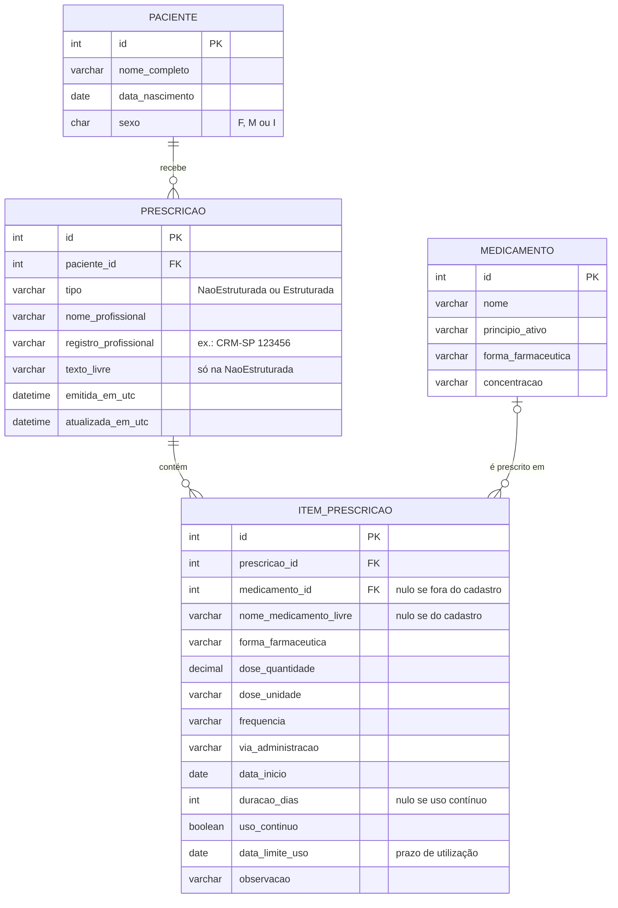

# Modelo de dados (DER)

Implementado em [`database/01-esquema.sql`](../database/01-esquema.sql), seguindo os [padrões de banco de dados](padroes-banco-de-dados.md).

## Relacionamentos

| Relação | Cardinalidade | Regra |
| --- | --- | --- |
| Paciente → Prescrição | 1 para 0..N | Toda prescrição tem um paciente; um paciente pode ter várias prescrições |
| Prescrição → Item | 1 para 0..N | A receita estruturada tem de 1 a 30 itens (regra do domínio, R03.1); a não estruturada não tem itens |
| Medicamento → Item | 0..1 para 0..N | O item aponta para um medicamento do cadastro **ou** traz o nome livre (ECF.10.03 b e c) |

## Decisões de modelagem

- **A relação N:N entre prescrição e medicamento é resolvida por `item_prescricao`,** que guarda o que pertence à prescrição: dose, frequência, via, início, duração, uso contínuo, prazo e observação (ECF.10.03 d). Os dados do medicamento (princípio ativo, concentração) ficam só no cadastro: terceira forma normal.
- **Os dois tipos de receita ficam na mesma tabela,** distinguidos por `tipo`. A não estruturada usa `texto_livre`; a estruturada usa os itens. Um `CHECK` garante que o texto livre exista só na não estruturada.
- **`medicamento_id` é opcional** para permitir medicamentos fora do cadastro, como os manipulados (ECF.10.03 c). Um `CHECK` exige exatamente uma das duas origens: o id do cadastro ou o nome livre.
- **`forma_farmaceutica` aparece no item e no medicamento** de propósito: no medicamento é a forma em que ele é fornecido; no item é a forma prescrita, obrigatória também para o medicamento fora do cadastro.
- **Exclusão em cascata só dos itens.** Excluir uma prescrição apaga os itens dela; paciente e medicamento usados em prescrições não podem ser excluídos.
- **Datas e horas em UTC** (`emitida_em_utc`), convertidas para o fuso do usuário na tela.

## Restrições que repetem regras do domínio

| Restrição | Regra |
| --- | --- |
| `ck_prescricao_tipo` | Tipo é `NaoEstruturada` ou `Estruturada` |
| `ck_prescricao_texto_livre` | ECF.10.01: texto livre só na receita não estruturada |
| `ck_item_prescricao_medicamento` | ECF.10.03 b e c: medicamento do cadastro ou nome livre, exatamente um |
| `ck_item_prescricao_duracao` | ECF.10.03 d: uso contínuo sem duração; senão, de 1 a 365 dias |
| `ck_item_prescricao_dose` | Dose maior que zero |
| `ck_item_prescricao_data_limite_uso` | Prazo de utilização não anterior ao início |

As regras que dependem de mais de uma linha (como "ao menos um item na receita estruturada") ficam só no domínio, porque um `CHECK` enxerga apenas a linha que está sendo gravada.
